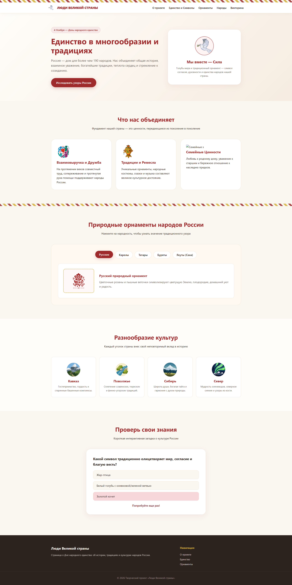

# Люди Великой страны

Одностраничный сайт был сделан в рамках проекта **"Межрегиональный конкурс «Люди Великой страны», посвященный Дню народного единства"**.
Страничка содержит информацию о Дне народного единства, традициях и культурах народов России.

Страница сделана с использованием технологий **HTML**, **CSS** и **JavaScript**.

Автор проекта: **Воронина Евгения**